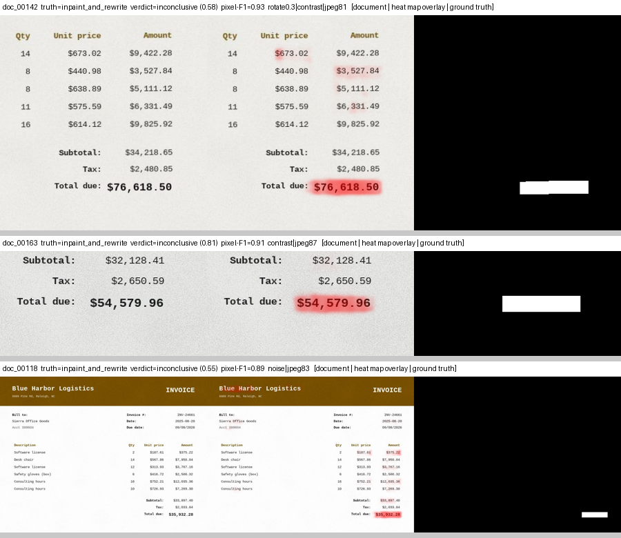
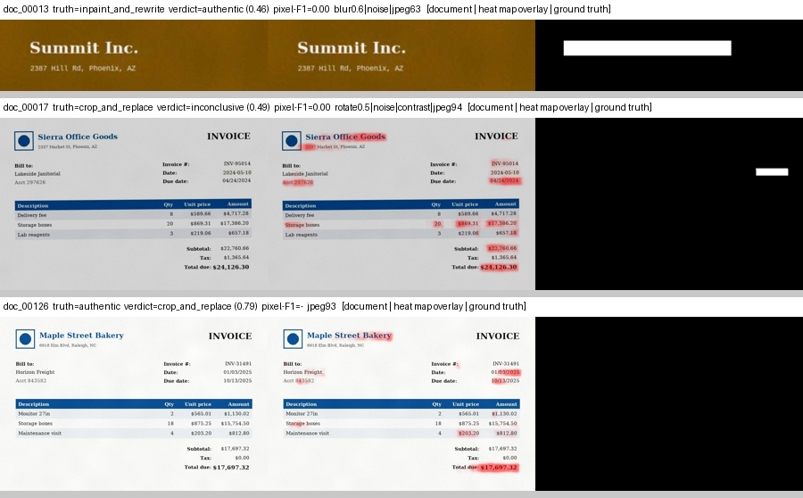

# Report: Document Tamper Detection

**Bottom line.** The full pipeline works end to end: synthetic data generator, training, calibrated decisions, scoring, and a `predict.py` that meets the CLI contract (about 0.5 s per page on CPU). The detector itself is weak. On held-out templates its image-level AUC is **0.61**, and on unseen fonts, layouts and phone/print capture it is **0.46**, which is chance level. It is a 0.7 M-parameter model trained for 50 minutes on a CPU, and I treat it as a working baseline, not a finished detector. The most reliable part of the system is its willingness to say `inconclusive` instead of accusing: it calls only 4% of authentic held-out pages tampered, at the price of calling 81% of all pages inconclusive and catching only 6% of forgeries outright.

## 1. Approach

**Data generator.** Invoices are rendered with PIL from 12 layout templates (font family, header style, table style, colours, two-column variants), recording every field's bounding box. Each page gets paper grain, shading and one JPEG save to give the original a capture history before anyone edits it. Two forgeries follow:

- `inpaint_and_rewrite`: erase a field with OpenCV inpainting (Telea or Navier-Stokes), then draw a changed value (1-3 digits altered). 60% of the time the document's own font is used, otherwise another family.
- `crop_and_replace`: paste the same field type from another rendered document captured at a JPEG quality 10-25 points away, so the patch carries a different grain and compression history.

The ground-truth mask is built from the same boxes used to edit, so it is exact by construction. Rotation, blur, noise, contrast and a final JPEG (q60-96) are applied after tampering, identically to every class including authentic pages. The `private` profile adds phone-photo and print-and-scan capture.

**Model (TamperNet, 0.70 M parameters).** Three branches fused at 1/8 resolution with cross-gating: an RGB encoder (font and layout cues), a noise encoder over three fixed SRM high-pass filters (grain removed by inpainting or foreign grain pasted in), and an 8x8 block-DCT branch (compression history). Output is a 3-class map (background / inpaint / crop) at half resolution, upsampled to input size. Heat = 1 - P(background). Training crops are 192x192 and start on multiples of 8 so the DCT branch stays aligned with the JPEG grid.

**Training.** 2,400 steps, batch 16, AdamW with OneCycle, loss = cross-entropy (class weights 1/2/2) + 0.3 x Dice. Crop mix: 35% on an edit, 30% on untouched fields of the same type as the forger targets, 25% on any ink, 10% random. Checkpoints were scored every 400 steps on calibration documents (pixel-F1 minus false-alarm area). `weights/train_log.txt` records only the loss, so which checkpoint was kept is not documented.

**Decisions.** Two signals per page: the model score (mean of the 2,000 hottest heat pixels, roughly one edited field) and a background-only ELA score. A logistic regression on the calibration set fuses them (shipped coefficients: model 1.88, ELA 0.70, bias -1.09). Thresholds come from a stated cost: `tampered` only above the score where at most 2% of authentic calibration pages are flagged, `authentic` only below the score that keeps 90% of tampered calibration pages above it, and `inconclusive` in between. `tamper_type` comes from the summed inpaint versus crop probabilities.

## 2. Shortcuts found during development

Each produced a model that looked fine on its training distribution while learning the wrong thing.

| # | What the model learned | Fix |
| --- | --- | --- |
| 1 | "Any text is tampered" (every edit is on text) | Hard negatives centred on untouched text |
| 2 | "Totals are tampered" (forgers pick totals most) | Negatives drawn from the same field types with the same weights |
| 3 | "Unfamiliar fonts are tampered" (substitute font drawn from families absent from genuine pages) | Substitute fonts limited to families seen in genuine pages |

A data bug also inflated early results: when a donor invoice had fewer line items than the target, the generator pasted a vendor banner into a table. Donors now supply the same field type.

## 3. Results

All numbers come from `evaluate.py` run on the shipped weights and calibration (re-measured on 2026-11-18). Held-out templates 6-7 are `data/val` (seed 2, 300 documents; regenerating them from the seed gives byte-identical files). Unseen templates 8-11 are `data/stress` (`private` profile, seed 5, 180 documents). Decision thresholds were set on templates 0-5 only.

| Metric | Held-out templates 6-7 | Unseen templates 8-11 (+ phone / print-scan) |
| --- | --- | --- |
| Image-level AUC | 0.615 | 0.459 |
| False-positive rate on authentic | 0.040 | 0.000 |
| Detection recall (called tampered) | 0.060 (crop 0.07, inpaint 0.05) | 0.017 |
| Inconclusive rate | 0.813 | 0.700 |
| Macro-F1 (inconclusive counts as wrong) | 0.155 | 0.076 |
| Pixel-F1 / IoU on tampered pages | 0.278 / 0.201 | 0.090 / 0.059 |

Per template on the held-out set: template 6 has AUC 0.554 and FPR 0.073, template 7 has AUC 0.762 and FPR 0.000. The 2% FPR target set on templates 0-5 is therefore not guaranteed on a new layout (n is small: about 50 authentic pages per template). AUC is similar across JPEG quality bands (0.60-0.64), so compression level is not what separates cases. On unseen templates the per-template AUC is 0.40-0.58, and by capture condition AUC is 0.56 for digital, **0.34 for phone photos and 0.42 for print-and-scan**, i.e. below chance, so the model's score is not just uninformative there but misleading. Zero false positives on that set comes from the detector rarely firing, not from it separating the classes.

On the assignment's 6 `examples/` every page, authentic and forged, comes back `inconclusive` (AUC 0.5, pixel-F1 0.004).

**Earlier numbers.** A previous version of this report quoted AUC 0.533 / FPR 0.24 on templates 6-7, and an even earlier run quoted AUC 0.647 / FPR 0.02. Neither matches the files now in `weights/` (the weights and `calibration.json` were modified after `train_log.txt` was written), so I discarded them and re-measured. If the weights are replaced again, re-run the commands in `README.md` and update this table.

**Signals.** The model score is the main signal. Page-level ELA adds little after a final recompression at quality 60-96 (it measures the final JPEG, not the edit); the fit still gave it a small positive weight (0.70 vs 1.88 for the model), which I have not shown to help on held-out data. Re-running `python -m tamperdoc.calibrate --data data/calib` reproduces the shipped `weights/calibration.json` exactly (same coefficients, bias and band), so the calibration is consistent with the shipped weights. On the calibration set the single-signal AUC is 0.618 for the model and 0.528 for ELA, and the fused score gives 0.617, i.e. no gain from ELA.

## 4. Examples

**Localisation hits.** Three inpainted amounts where the heat map sits on the edit (pixel-F1 0.89-0.93). The verdict for all three is still `inconclusive` (scores 0.55-0.81), so these are localisation successes, not confident detections.

**Failures** (figure columns: document, heat overlay, ground truth):

1. `doc_00013`, inpainted vendor name on a dark banner, JPEG 63 with blur and noise: no heat at all and verdict `authentic` (0.46). Blur plus recompression remove the grain difference the noise branch relies on, and the edit is not on a field type seen often in training.
2. `doc_00017`, pasted date at JPEG 94: verdict `inconclusive`, pixel-F1 0.00. Heat spreads over the vendor, bill-to, amounts and dates but not the pasted region, which is the "edits are usually on money and dates" prior rather than a forensic trace.
3. `doc_00126`, **authentic** page flagged `crop_and_replace` (0.79): heat on the total, dates and amounts of a clean page. This is the costly error the task warns about, caused by the same field-type prior.

## 5. What I would do with two more weeks

1. Train on a GPU with a larger backbone and 50-100x the crops; the loss was still falling.
2. Try published forensic models zero-shot (TruFor, CAT-Net v2, IML-ViT, MVSS-Net) and keep the best per tamper type.
3. Break the position prior with paired data: every forgery gets its identical untampered twin, so the only difference is the edit.
4. Add more fonts and capture conditions (perspective, uneven light, print-and-scan).
5. Add content checks independent of pixels: quantity x price = amount, amounts sum to subtotal, plausible dates.
6. Obtain even 50 real tampered documents for testing only.
7. Retrain and recalibrate so the held-out FPR actually meets the 2% target, using several held-out layouts for calibration.

## 6. Models, datasets and licences

No pretrained models and no external datasets. Libraries: numpy (BSD-3), Pillow (HPND), opencv-python-headless (Apache-2.0), scikit-learn (BSD-3), PyTorch (BSD-3). Fonts: DejaVu (Bitstream Vera-derived free licence), Liberation (SIL OFL 1.1), GNU FreeFont (GPLv3 with font exception). All training data is synthetic and generated by `tamperdoc/generate.py`.

## 7. Reproducing

Commands are in `README.md`. Hardware: Apple M1 Pro, 10 cores, 32 GB, macOS 26, Python 3.12.4 (CPU). Training of the shipped weights ran 2,400 steps (about 50 minutes, per `weights/train_log.txt`); CPU training is not bit-for-bit deterministic.
